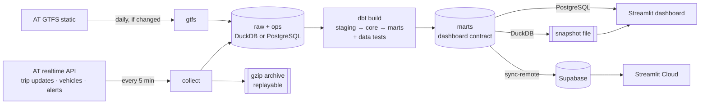

# Bus Checker

Bus Checker measures how reliably Auckland's buses, trains and ferries run. Every five
minutes Airflow collects Auckland Transport's realtime feeds (trip updates, vehicle positions
and service alerts) into **DuckDB or PostgreSQL**. dbt turns them into tested reliability
marts, and a Streamlit dashboard presents them in twelve pages. The same marts can be
published to a free hosted PostgreSQL (Supabase) for an online Streamlit app.



## Quick start (Docker)

Requirements: Docker Desktop (Linux containers) and an [AT developer](https://dev-portal.at.govt.nz/)
subscription key.

```powershell
Copy-Item .env.example .env        # then set AT_SUB_KEY in .env
docker compose up -d --build       # BUS_BACKEND=postgres by default; set BUS_BACKEND=duckdb to switch
docker compose ps
```

* Dashboard: <http://127.0.0.1:8501>
* Airflow: <http://127.0.0.1:8080>, user `admin`. Get the generated password with
  `docker compose exec airflow-apiserver cat /opt/airflow/state/passwords.json`

The `bus_realtime` DAG starts enabled. The first run downloads the GTFS timetable (about a
minute); after that each run takes seconds. Keep the machine awake: realtime data that was not
collected cannot be recovered later.

| Service | Role |
| --- | --- |
| `postgres` | Airflow metadata (`airflow` DB) and the warehouse (`bus` DB) with separate owners; `bus_reader` can read only the `marts` schema |
| `airflow-init` | One-shot: migrates Airflow, creates the `bus_warehouse` pool and the warehouse tables |
| `airflow-apiserver`, `airflow-scheduler`, `airflow-dag-processor` | Airflow 3 with the LocalExecutor (no `standalone`) |
| `dashboard` | Streamlit, reading the marts through the read-only role (PostgreSQL) or the published snapshot (DuckDB) |

Only ports 8080 and 8501 are published, on loopback only. Switching backend: `docker compose down`,
set `BUS_BACKEND`, `docker compose up -d`. Each backend keeps its own volume.

## Native development

```powershell
python -m venv .venv
.\.venv\Scripts\python.exe -m pip install -r requirements-dev.txt
.\.venv\Scripts\python.exe -m bus_checker run-once     # collect + GTFS (if due) + dbt build + snapshot
.\.venv\Scripts\python.exe -m streamlit run streamlit_app.py
```

Native runs default to DuckDB under `data/` (git-ignored). The `Makefile` wraps the same
commands (`make setup`, `make run-once`, `make dashboard`, `make test`).

## Commands

`python -m bus_checker <command>` prints a JSON summary and returns a non-zero exit code on failure.

| Command | Purpose |
| --- | --- |
| `init` | Create schemas and tables (idempotent) |
| `collect [--feed …] [--run-id …]` | Fetch the three feeds concurrently, load each in its own transaction |
| `replay PATH…` | Reload archived `.json.gz` (or plain JSON) payloads; safe to repeat |
| `gtfs [--if-due] [--force] [--source URL\|zip\|dir]` | Refresh GTFS reference data |
| `build [--full-refresh] [--full-tests] [--select …]` | `dbt build`; outcome recorded in `ops.dbt_runs` |
| `publish-snapshot` | DuckDB only: publish the marts to the dashboard snapshot |
| `sync-remote [--full]` | Publish the marts to `BUS_PUBLISH_URL` |
| `maintain` | Retention for archives, raw rows and audit rows; vacuum/checkpoint |
| `run-once` | One scheduler tick without Airflow |
| `status` | Row counts and latest fetch per feed |

## How the data is processed

**Collect.** Each fetch is hashed. An identical payload to the previous one is recorded as
`unchanged` and skipped. New payloads are archived (gzip, `BUS_ARCHIVE_DIR`) and parsed by pure
parsers, then loaded. Every record gets a deterministic ID derived from its content, so the
same vehicle report seen in many snapshots is stored once, and replays are idempotent.
Malformed records go to `ops.quarantine` with a reason code; the rest of the feed still loads.
Rows, quarantine and the `ops.fetch_runs` audit row commit together.

**Observed, not predicted.** AT reports the delay at the stop a vehicle has just served. Stop
events whose time is still in the future relative to the feed are predictions, and they are
excluded. The warehouse keeps the latest observed report per trip and stop (`core.fct_stop_events`).

**Stable keys.** AT route IDs carry a contract/version suffix (`101-202`, `122-203`); routes are
analysed by their public number (`route_key` = `101`). Stops are keyed by stop code. History
therefore stays continuous across timetable versions.

**Incremental by service date.** Facts and marts are rebuilt per service-date partition. Only
dates that received data since the model's watermark (minus a safety margin) are rebuilt, so
a 5-minute build stays fast regardless of history size. Late or replayed data simply reopens
its date. `build --full-refresh` rebuilds everything from raw.

**Tested.** 47 dbt data tests run on every build: uniqueness of every grain, punctuality classes
that partition each count, and reconciliation of each layer against the layer below. Routine
builds test the last 3 days; the daily `bus_maintenance` DAG tests the full history. A failing
test stops downstream models, so the dashboard keeps showing the last good publication.

| Schema | Owner | Contents |
| --- | --- | --- |
| `raw` | Python | `trip_updates`, `vehicle_positions`, `service_alerts`(+`_entities`), `gtfs_*` |
| `ops` | Python | `fetch_runs`, `quarantine`, `gtfs_loads`, `dbt_runs`, `publications`, `schema_info` |
| `staging` | dbt | Typed, renamed views over `raw` and `ops` |
| `core` | dbt | `fct_stop_events`, `fct_trips`, `fct_scheduled_service`, holiday seed |
| `marts` | dbt | The dashboard contract (25 tables, listed in `bus_checker/publish/contract.py`) |

Definitions: on time is −60 s to +300 s inclusive. Percentiles come from one-minute delay
buckets. A cancelled trip is one whose latest report is `CANCELED` with no observed stop.
Day types use the NZ public-holiday seed (`bus_dbt/seeds`), which must be extended each year.

## Dashboard

| Section | Pages |
| --- | --- |
| Overview | **Network pulse**: KPIs with period-over-period deltas, punctuality mix, delay trend, hourly profile, best/worst routes |
| Live | **Live map** (auto-refresh, delay colours, route shapes, crowding); **Service alerts** (active/scheduled, search, timelines) |
| Reliability | **Routes** (ranking, unpredictability, stop-by-stop delay profile, distribution, cancellations, alerts); **Compare routes**; **Time patterns** (weekday × hour heatmap, peaks, weekday baseline); **Stop hotspots**; **Operators** |
| Service | **Service delivery** (scheduled vs tracked vs cancelled); **Fleet & crowding** (vehicles in service, occupancy, speed) |
| Data | **Pipeline health** (freshness, failures, feed lag, dbt results, quarantine, GTFS loads); **Methodology** |

Period, mode and day-type filters are shared across pages. Every query reads the `marts`
schema only and aggregates in the database.

## Publishing online (Supabase + Streamlit Community Cloud)

1. Create a free Supabase project and run `deploy/supabase/setup.sql` in its SQL editor (set
   the two passwords first). The script creates a publisher role and a read-only dashboard role.
2. Locally, add to `.env` and restart the stack:
   `BUS_PUBLISH_URL=postgresql://bus_publisher.<ref>:<pw>@aws-0-<region>.pooler.supabase.com:5432/postgres?sslmode=require`
   This enables the `bus_publish_remote` DAG, every 15 minutes (`BUS_PUBLISH_SCHEDULE`).
   Each publication is one transaction. Recent days are always replaced; older days only when
   their row count changes; unchanged small tables are skipped. Retention windows keep the free
   500 MB tier in check: daily marts 400 days, hourly 62, stop detail 31
   (`BUS_PUBLISH_*_DAYS`).
3. On [Streamlit Community Cloud](https://share.streamlit.io), deploy this repository with
   `streamlit_app.py` as the entry point and the secrets from
   `deploy/streamlit-cloud/secrets.toml.example`. The cloud app installs only `requirements.txt`.

Local collection continues independently; the online app shows the latest complete
publication and its age.

## Testing and CI

```powershell
.\.venv\Scripts\python.exe -m pytest -q                      # unit + integration (DuckDB)
$env:BUS_TEST_POSTGRES_URL = "postgresql://postgres:pw@localhost:5432/postgres"
.\.venv\Scripts\python.exe -m pytest -q                      # adds the PostgreSQL end-to-end test
bash tests/stack/run_stack.sh                                  # full Docker stack against fixture feeds
```

The integration tests run the real pipeline end to end: collection, GTFS, two incremental dbt
builds with full tests, snapshot, remote publication and every dashboard page, on DuckDB and
on PostgreSQL. GitHub Actions runs ruff, `dbt parse` and the test suite with a PostgreSQL
service, then the Docker stack for both backends.

## Configuration

All settings are environment variables (a root `.env` is read for native runs); see
`.env.example`. The main ones:

| Variable | Default | Meaning |
| --- | --- | --- |
| `AT_SUB_KEY` | — | AT API subscription key |
| `BUS_BACKEND` | `duckdb` (native), `postgres` (Docker) | Warehouse |
| `BUS_DUCKDB_PATH` / `BUS_SNAPSHOT_PATH` | `data/warehouse/bus.duckdb` / `data/published/bus_dashboard.duckdb` | DuckDB files |
| `BUS_POSTGRES_URL` or `PG*` | — | PostgreSQL connection |
| `BUS_ARCHIVE_DIR` / `BUS_ARCHIVE_RETENTION_DAYS` | `data/archive` / 14 | Raw payload archive (`off` disables) |
| `BUS_RAW_RETENTION_DAYS` | 0 (keep) | Raw warehouse rows |
| `BUS_GTFS_REFRESH_HOURS` | 24 | GTFS refresh interval (unchanged feeds are skipped) |
| `BUS_PUBLISH_URL` | — | Remote publication target |

Data: Auckland Transport, licensed under [CC BY 4.0](https://dev-portal.at.govt.nz/). Map tiles
© OpenStreetMap contributors © CARTO.
